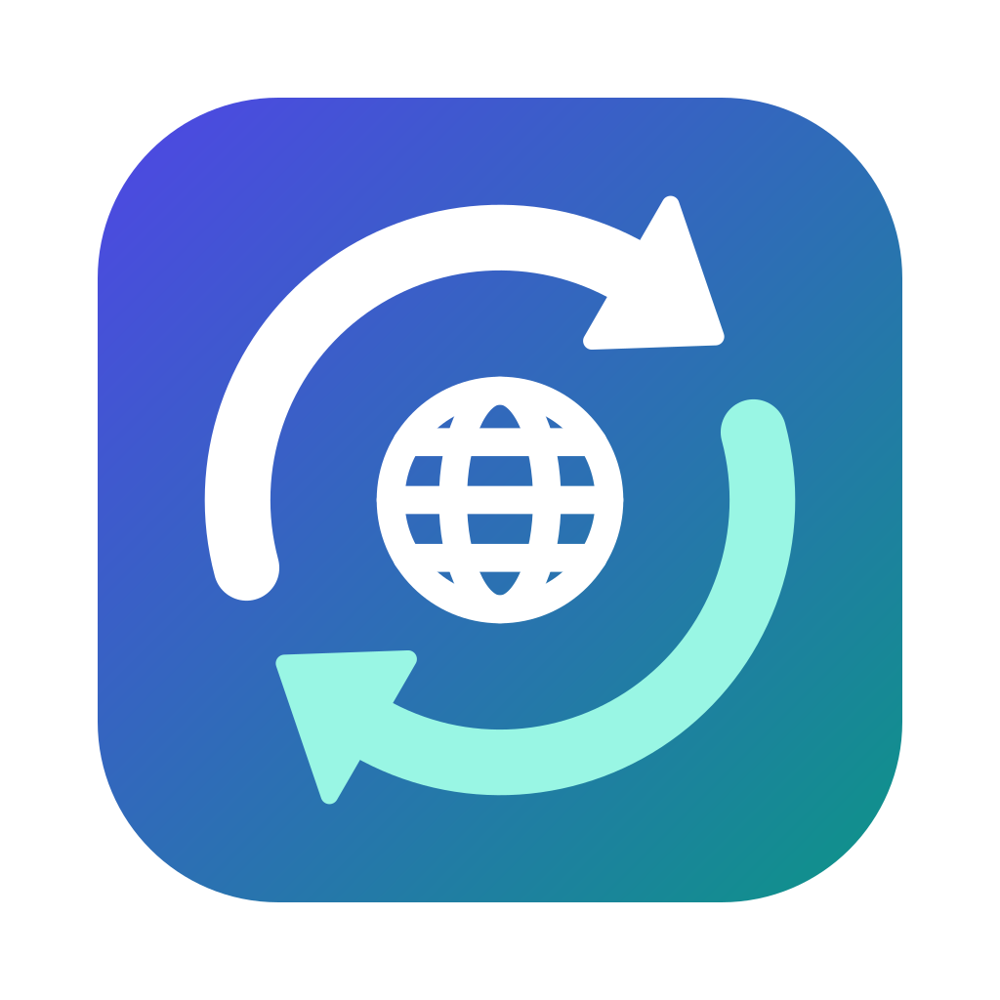
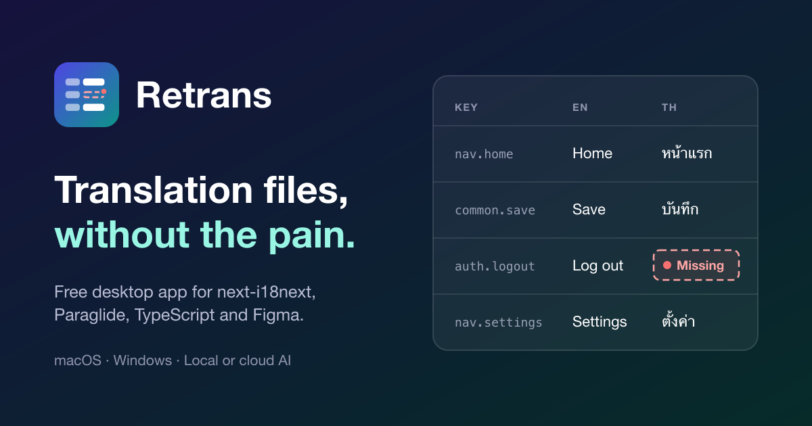

<p align="center">
  
</p>

<h1 align="center">Retrans</h1>

<p align="center">
  A free desktop app for editing translation files: next-i18next, Paraglide, TypeScript and Figma, in one grid, with local or cloud AI to fill the gaps.
</p>

<p align="center">
  <a href="https://github.com/oxth/retrans/releases/latest"><b>Download</b></a> ·
  <a href="https://oxth.github.io/retrans/">Website</a> ·
  <a href="docs/guide.md">Guide</a> ·
  <a href="CHANGELOG.md">Changelog</a>
</p>

<p align="center">
  <a href="https://github.com/oxth/retrans/releases/latest"></a>
  <a href="LICENSE"></a>
  
</p>

<p align="center">
  
</p>

Retrans shows every key and language side by side, makes missing translations impossible to miss, tracks what has been reviewed, and saves only what you changed, so your git diffs stay small. No account, no server, no usage limits.

## Download

| Platform | Requirements |
| --- | --- |
| [macOS](https://github.com/oxth/retrans/releases/latest) | Apple Silicon (M1 and later), macOS 11 Big Sur or newer |
| [Windows](https://github.com/oxth/retrans/releases/latest) | Windows 10 or 11, 64-bit |

Once installed, Retrans updates itself: new versions are offered inside the app.

### First launch

Releases aren't code-signed yet, so the system warns the first time you open Retrans.

- **macOS:** open the app once (macOS says it can't verify the developer), then go to **System Settings → Privacy & Security**, scroll down and click **Open Anyway**. On macOS 14 and older you can also right-click the app and choose **Open**. If macOS ever says the app "is damaged", run `xattr -cr /Applications/Retrans.app` once in Terminal and open it again.
- **Windows:** when SmartScreen appears, click **More info**, then **Run anyway**.

## Supported formats

| Format | How Retrans opens it |
| --- | --- |
| **next-i18next** (JSON) | Directly. Saves rewrite only the values you changed; key order, formatting and comments stay as they were. |
| **Paraglide / inlang** | Directly, the same way. |
| **TypeScript locale modules** | Imported into a workspace that syncs when your code changes and writes back a minimal diff. |
| **Figma Variables** (`.tokens.json`) | Opened directly or imported into a workspace; export back changes only the text values. |

A workspace can also be exported to i18next JSON or Paraglide, and **New project** starts one that isn't tied to any format.

## Features

- **One grid for every key and language,** as a list or a table. Missing translations stand out, and Tab jumps to the next one.
- **Review status that travels.** Every translation is missing, waiting for review or reviewed. When the base text changes, the cell says **Needs review**. Status lives in `.retrans/` and is shared through git.
- **Local or cloud AI.** A built-in model (TranslateGemma or Qwen) runs entirely on your computer. You can also use OpenAI, Claude, any OpenAI-compatible API (OpenRouter, Groq, DeepSeek, Ollama, LM Studio…), or an AI agent you already have through ACP (Claude Code, Codex, Gemini CLI).
- **Many languages in one run.** Translate every missing string in all your languages at once, with your own instructions for tone and terms, per project or per language.
- **Translator packages.** Send a translator a `.zip`. They open it in Retrans and send it back, and you import their work with a clear view of what changed and any conflicts.
- **Tabs, auto-save and undo.** Keep several projects open, never lose an edit (even after a crash), and undo anything, including a whole AI translation run.
- **Light and dark mode,** following your system.

The [guide](docs/guide.md) covers each of these in detail.

## Privacy

Retrans has no account and no telemetry. With the built-in model, your text never leaves your computer: the only network traffic is the model download from huggingface.co and update checks on github.com. Text is sent elsewhere only if you choose a cloud provider or an AI agent, and Retrans asks first, naming where it goes. API keys are stored in the macOS Keychain or Windows Credential Manager, never in files.

## Build from source

You need Node.js 20.16+ (or 22.3+), pnpm, Rust with the [Tauri 2 prerequisites](https://tauri.app/start/prerequisites/), and CMake.

```sh
pnpm install
pnpm tauri dev
```

[CONTRIBUTING.md](CONTRIBUTING.md) covers tests, builds and releases.

## License

Retrans is free and open source under the [MIT License](LICENSE).

The optional TranslateGemma models are covered by their own Gemma terms of use, which the app shows before you download one.
